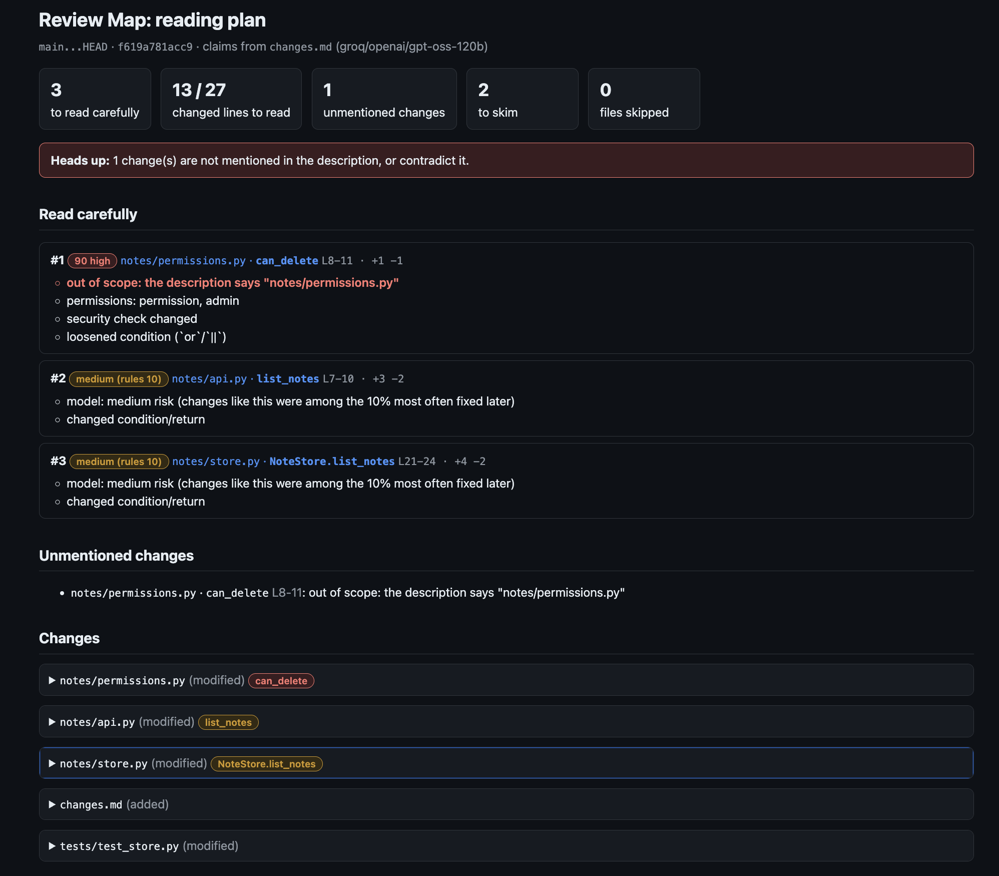
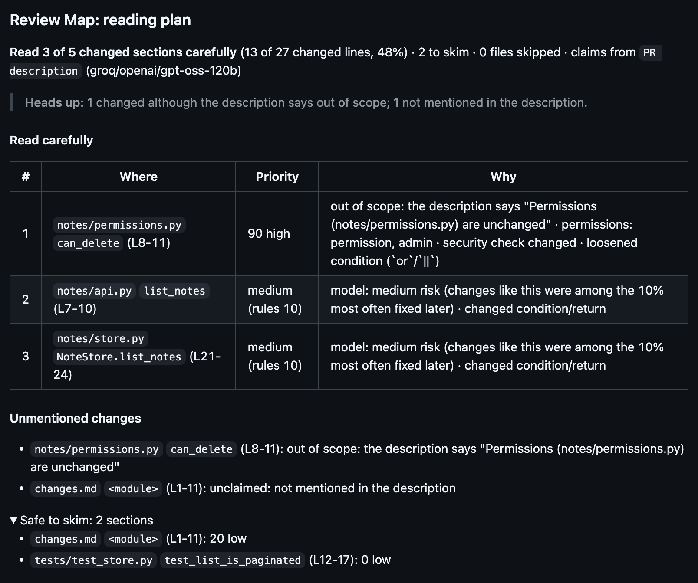
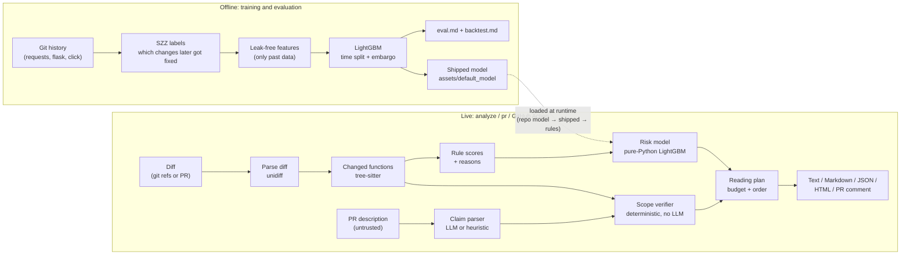

# Review Map

**A reading plan for reviewing AI-generated pull requests: what to read carefully, in which
order, and what the description didn't tell you.**

[](https://github.com/EshanGoel07/review-map/actions/workflows/ci.yml)


## The problem

AI coding agents now write pull requests faster than people can review them. The
bottleneck has moved from writing code to **reading** it. Two things make that worse:

- **The description can't be trusted.** An agent's summary says what it *meant* to do, not
  what the diff does. A risky edit, like a loosened permission check, can sit unmentioned
  in a PR whose description talks only about pagination.
- **AI reviewers add more to read.** Tools that answer with a pile of comments make the
  reviewer's job longer, not shorter.

## What Review Map does differently

Review Map doesn't review the code for you. It tells you **where to spend your attention**.

1. **Verify, don't trust: the scope check.** The PR description is parsed into a claimed
   scope (files, functions, behaviours, "out of scope" statements). Plain, deterministic
   code, with no LLM, then compares it with the actual diff, function by function, and lists:
   - **unmentioned changes**: functions changed but never claimed;
   - **contradictions**: changes to things the description says are out of scope or
     unchanged;
   - **claimed but missing**: things the description says changed, but didn't.

   This is the main feature. The description is treated as untrusted input, never as truth.
2. **A reading plan instead of more comments.** One short list, "read these few sections
   carefully, in this order, skim the rest", within a reading budget (by default 15% of the
   changed lines, at most 5 sections). It's available as terminal text, Markdown, JSON, a
   self-contained HTML report, or one auto-updating PR comment.
3. **An effort-aware risk model, evaluated honestly.** Every changed function gets
   rule-based reasons (auth, permissions, raw SQL, `eval`, removed checks…). A small
   LightGBM model trained on the git history of real projects adds "changes like this were
   often fixed later". Its evaluation, including where it **doesn't** beat simple
   baselines, is published in full ([below](#evaluation-results)).

## Quick start (under 5 minutes)

Requires Python 3.11+ and git.

```bash
# 1. Install (from GitHub; uv or pipx)
uv tool install git+https://github.com/EshanGoel07/review-map
#   or: pipx install git+https://github.com/EshanGoel07/review-map

# 2. Try it on the demo: a "pagination" change that quietly lets anyone delete notes
git clone https://github.com/EshanGoel07/review-map && cd review-map
python examples/demo_repo/build.py /tmp/review-map-demo
review-map analyze --repo /tmp/review-map-demo --base main
review-map analyze --repo /tmp/review-map-demo --base main --format html --out report.html

# 3. Optional: an LLM for reading descriptions (Groq has a free tier) and a GitHub token
review-map setup

# 4. Check everything works
review-map doctor

# 5. Use it on your own work
cd /path/to/your/repo
review-map analyze --base main                       # your branch vs main (uses changes.md if present)
review-map analyze --base main --desc pr-body.md     # or any description file
review-map pr owner/repo#123                         # any public GitHub PR
```

**No keys are needed to start.** Without an LLM, a heuristic parser reads descriptions
(marked "low confidence"). Without `GITHUB_TOKEN`, public PRs work at GitHub's 60
requests an hour. When a key would help, Review Map prints a one-line hint.

Other commands: `review-map --help`, and `review-map COMMAND --help` for each one.

| Command | What it does |
|---|---|
| `analyze` | The reading plan for two git refs (`--format text\|md\|json\|html`, `--fail-on high\|medium`) |
| `pr OWNER/REPO#N` | The reading plan for a GitHub PR (URL works too) |
| `verify` | Only the scope check: description vs diff |
| `diff`, `units`, `score`, `claims` | The individual pipeline steps, for inspection |
| `setup`, `doctor` | First-run wizard and setup check |
| `train --repo PATH` | Train a risk model on your own repo's history (needs `[train]` extra) |
| `backtest`, `mine`, `evaluate` | Reproduce the evaluation (needs `[train]` extra) |

## GitHub Action

Listed on the GitHub Marketplace as
[**Review Map Reading Plan**](https://github.com/marketplace/actions/review-map-reading-plan).
Add `.github/workflows/review-map.yml` to your repo:

```yaml
name: Review Map

on:
  pull_request: # not pull_request_target: that would hand secrets to fork PRs' code
    types: [opened, synchronize, reopened, edited]

permissions:
  contents: read
  pull-requests: write # to post and update the comment

concurrency:
  group: review-map-${{ github.event.pull_request.number }}
  cancel-in-progress: true

jobs:
  reading-plan:
    runs-on: ubuntu-latest
    steps:
      - uses: actions/checkout@v5
        with:
          fetch-depth: 0 # the base, the head and their merge base
          persist-credentials: false

      - uses: EshanGoel07/review-map@v0.1.0
        env:
          GROQ_API_KEY: ${{ secrets.GROQ_API_KEY }} # optional
        with:
          fail-on: "" # "high" or "medium" fails the check; the comment is posted either way
```

- **Secrets:** add an LLM key as a repository secret (Settings → Secrets and variables →
  Actions), e.g. `GROQ_API_KEY`. It's optional: without one, the comment says a heuristic
  parser was used. `GITHUB_TOKEN` is provided by Actions automatically.
- **Permissions:** `pull-requests: write` to post the comment and `contents: read` for the
  checkout. Review Map posts **one** comment and updates it on every push; it never adds a
  second one.
- **Inputs:** `fail-on`, `budget` (max sections), `provider`, `model`, `github-token`,
  `python-version`. See [`action.yml`](action.yml).
- **Fork PRs:** GitHub gives workflows triggered by forks no secrets, so the LLM parser is
  off there and the comment says so. With the default read-only token for forks, posting
  may also fail; the plan is still written to the run's job summary. Don't switch to
  `pull_request_target` to work around this: it would run untrusted code with your
  secrets.
- **Trust:** for PRs, `.reviewmap.yml` and any repo model are read from the **base**
  commit, so a PR can't change its own configuration or scoring.

## Example output

The demo PR's description says it adds pagination, and that permissions are unchanged.
Terminal output:

```text
Read carefully (3 of 5 sections, 13 of 27 changed lines; budget 40 lines, 5 sections)
 # ┃          Priority ┃ Unit                      ┃ Why
━━━╇━━━━━━━━━━━━━━━━━━━╇━━━━━━━━━━━━━━━━━━━━━━━━━━━╇━━━━━━━━━━━━━━━━━━━━━━━━━━━━━━━━━━━━━━━━━━━
 1 │           75 high │ notes/permissions.py:8-11 │ out of scope: the description says
   │                   │ can_delete                │ "Permissions (`notes/permissions.py`) are
   │                   │                           │ unchanged."; permissions: permission, admin;
   │                   │                           │ security check changed; loosened condition
   │                   │                           │ (`or`/`||`)
 2 │ medium (rules 10) │ notes/api.py:7-10         │ model: medium risk (changes like this were
   │                   │ list_notes                │ among the 10% most often fixed later);
   │                   │                           │ changed condition/return
 3 │ medium (rules 10) │ notes/store.py:21-24      │ model: medium risk (...); changed
   │                   │ NoteStore.list_notes      │ condition/return

Unmentioned changes (1)
  • notes/permissions.py:can_delete out of scope: the description says "Permissions
    (`notes/permissions.py`) are unchanged."

Safe to skim: 2 sections (changes.md, test_list_is_paginated)
Risk: rules + shipped default model (shown as levels; not calibrated, so no percentages or
risk-coverage estimate).
```

HTML report (`--format html`): the diff with the sections to read highlighted and the
reasons beside them.



The PR comment posted by the GitHub Action:



## Architecture



- **Scope verifier** (`verify/scope.py`) is plain code: the LLM only turns prose into a
  structured claim, and it never decides what's in or out of scope.
- **Risk scorer** (`risk/scorer.py`) picks a model through a fallback chain: a model
  trained on your repo (`review-map train`, saved in `.reviewmap/model/`), else the shipped
  model, else rules only. A missing or broken model falls back with a note, never a crash.
  The model runs in plain Python, so LightGBM isn't needed to use it.

## Configuration

Everything is optional. Put a `.reviewmap.yml` in the repo root
(full example: [`examples/reviewmap.yml`](examples/reviewmap.yml)):

```yaml
ignore:                   # left out of the plan (still listed as ignored); .gitignore-style globs
  - "docs/"
  - "**/__snapshots__/"
sensitive_paths:          # always count as risky, on top of the built-in rules
  - "src/billing/"
reading_budget:
  lines_fraction: 0.15    # share of changed lines to read carefully
  max_units: 5            # at most this many sections
  min_lines: 40           # but always allow at least this many lines
llm:
  provider: null          # groq | gemini | anthropic | openai | ollama; null = first key found
  model: null             # null = the provider's default
```

Unknown keys are rejected, so a typo is reported instead of silently ignored.
`review-map doctor` validates the file.

### LLM providers

The LLM only turns the description into a structured claim. Keys come from environment
variables or a gitignored `.env` (`review-map setup` writes it; see
[`.env.example`](.env.example)). Environment variables win over `.env`, which wins over
`.reviewmap.yml`.

| Provider | Key variable | Default model | Notes |
|---|---|---|---|
| **Groq** (default) | `GROQ_API_KEY` | `openai/gpt-oss-120b` | free tier, fast |
| Google Gemini | `GEMINI_API_KEY` | `gemini-2.5-flash` | free tier |
| Anthropic | `ANTHROPIC_API_KEY` | `claude-haiku-5-5` | official SDK |
| OpenAI | `OPENAI_API_KEY` | `gpt-4o-mini` | |
| Ollama | none | `llama3.1:8b` | local and offline (`ollama serve`) |
| none | | | heuristic parser, marked low confidence |

Set `REVIEW_MAP_LLM_PROVIDER` and `REVIEW_MAP_LLM_MODEL` to choose explicitly. Without
them, the first provider whose key is set is used (Groq, Gemini, Anthropic, OpenAI).
`REVIEW_MAP_LLM_BASE_URL` points to any OpenAI-compatible server. Answers are cached on
disk; use `--no-cache` to ask again.

## Evaluation results

The risk model was trained and tested on the git history of **psf/requests,
pallets/flask and pallets/click**: about 21,000 changed functions, 7% later changed by a
bug fix (function-level SZZ labels). It was tested on the newest 15% of each project,
which it never saw. Full details: [`reports/eval.md`](reports/eval.md),
[`reports/backtest.md`](reports/backtest.md), and every methodology decision, marked
before or after seeing results, in [`reports/DECISIONS.md`](reports/DECISIONS.md).

**Ranking quality** (later-fixed functions read when reading 20% of changed lines, test set):

| Ranking | Recall @20% lines |
|---|---:|
| Model risk ÷ lines (chosen on validation, used by Review Map) | **53.7%** |
| Smallest change first | 53.2% |
| Rule score ÷ lines | 41.9% |
| Random | 21.0% |
| Rule score alone | 17.7% |

**Backtest of the real reading plan** (666 held-out commits replayed as PRs, default budget):

| Plan | Later-fixed functions read | Changed lines read |
|---|---:|---:|
| Review Map (rules + model) | 60.6% | 37.4% |
| Review Map, rules only | 16.8% | 24.6% |
| Random, same budget | 61.5% | 27.6% |

What this means, honestly:

- **The model ties "read the smallest changes first".** Its 53.7% vs 53.2% is within noise.
  Cross-project (train on requests + flask, test on click) it's also a tie: 32.2% vs 31.7%.
- **The full plan doesn't beat random reading** at catching later-fixed code, at the same
  budget. Small commits fit the 40-line floor and get read in full whatever the order.
- **The "high" level is meaningful but rare:** 2.7% of functions, and 17.9% of those were
  later fixed, 3.5× the 5.1% base rate.
- **Calibration failed** (ECE 0.023 vs a 0.02 target). So Review Map shows risk *levels*,
  never percentages, and no "risk coverage" estimate.
- **The scope check can't be backtested.** Commit history has no PR descriptions, so the
  main feature isn't measured by these numbers.
- Labels are noisy. "Later changed by a fix commit" is a proxy for "had a bug". The model
  is not a bug detector, and a low level never means a change is correct.

## Security and privacy

- **Runs locally.** Your code goes nowhere except, optionally, the PR description to the
  LLM provider *you* choose. With Ollama, or no LLM, nothing leaves your machine. The diff
  isn't sent to the LLM.
- **PR text is untrusted.** Descriptions, titles, paths and code can contain prompt
  injection. The LLM is told to treat them as data, its output is validated against a
  schema, and it never decides scope: the verifier is deterministic. Markdown output is
  escaped (no links, images, HTML or @-mentions from PR text). In Actions, PR-derived log
  lines can't run workflow commands.
- **Keys only from the environment.** Keys come from env vars or a gitignored `.env`, and
  are never written to config or printed. `doctor` reports only "set" and "works".
  `setup` writes `.env` readable by you only, and warns if it isn't gitignored. Inside
  GitHub Actions, `.env` files are ignored, because the working tree is the PR's own code.
- **Base-commit config.** For PRs, `.reviewmap.yml` and models are read from the base
  commit, never from the PR.
- **No telemetry.** Review Map makes no network calls except to the LLM provider and
  GitHub API you configure.

## Limitations and roadmap

**Limitations**
- Python, JavaScript and TypeScript only. Other files are listed but not mapped to
  functions.
- The risk model was trained on three mature Python libraries, and it ties simple
  baselines (see above).
- The heuristic parser (no LLM) misses claims written as plain prose. An LLM is much better
  at it.
- Compares two committed refs. Uncommitted changes aren't analysed yet.

**Roadmap**
- **Phase 10b: a better model.**
  - More and more varied repos.
  - Just-in-time defect features: author experience, change entropy, and so on.
  - An effort-aware objective (LambdaRank) instead of plain classification.
  - Cleaner labels (issue-linked fixes, refactoring-aware SZZ).
  - A fresh-holdout evaluation, since the current test period informed post-hoc decisions.
  - The risk-coverage estimate, once a model passes calibration.
- A GitHub App (no workflow file needed).
- More languages (Go, Java, Rust) through tree-sitter grammars.
- A `--working-tree` mode for uncommitted changes.

## Development

```bash
git clone https://github.com/EshanGoel07/review-map && cd review-map
uv sync                       # .venv with dev tools and the [train] extra
uv run pytest -q              # tests: no network, LLM and GitHub are mocked
uv run ruff check .           # lint
uv run ruff format --check .  # formatting
```

On macOS, training (not normal use) needs `brew install libomp` for LightGBM.

```
src/review_map/
  cli.py            commands (typer)        pipeline.py   diff → plan wiring
  diff/             git + GitHub PR input   code/         tree-sitter function mapping
  risk/             rules, features, model reader, scorer (fallback chain)
  claims/           LLM client + claim parser (untrusted input)
  verify/           deterministic scope verifier
  report/           reading plan + text/Markdown/JSON/HTML renderers
  github/           GitHub API client + Action entry point
  training/         mining (SZZ), training, evaluation, backtest
  assets/           shipped model + model card
  doctor.py, setup_wizard.py
tests/              unit and end-to-end tests (fixtures, snapshots)
reports/            eval.md, backtest.md, DECISIONS.md, metrics.json
examples/           demo repo, workflow, config
```

How it was built, phase by phase, with test results and decisions:
[`PHASE_LOG.md`](PHASE_LOG.md). Changes: [`CHANGELOG.md`](CHANGELOG.md).

## License

MIT. See [LICENSE](LICENSE).
